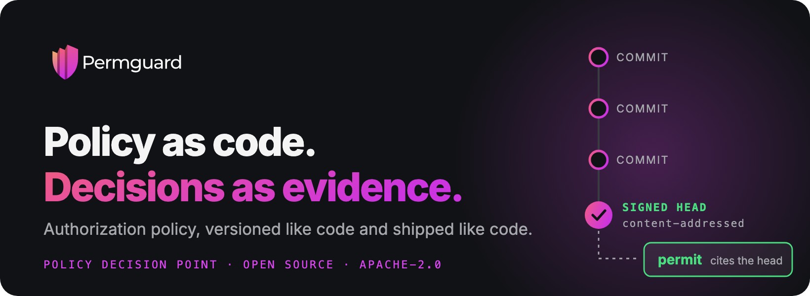
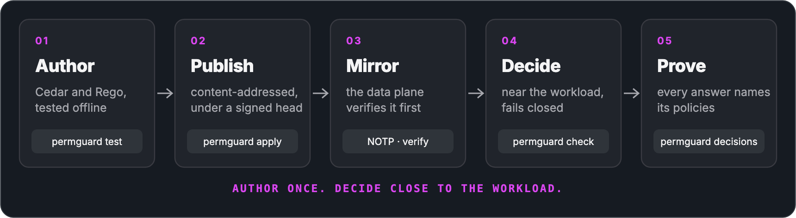
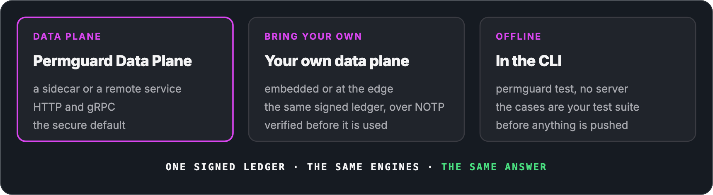

<!-- Copyright (c) 2022 Nitro Agility S.r.l. -->
<!-- SPDX-License-Identifier: Apache-2.0 -->

# Permguard

[](https://github.com/permguard/permguard/actions/workflows/ci.yml)
[](LICENSE)

<p align="center">
  
</p>

<p align="center">
  <a href="https://permguard.com"><b>Website</b></a> ·
  <a href="https://docs.permguard.com/"><b>Documentation</b></a> ·
  <a href="#five-minutes"><b>Five minutes</b></a> ·
  <a href="https://github.com/permguard/soglia"><b>Soglia</b></a>
</p>

**Authorization policy, versioned like code and shipped like code.**

Permguard keeps your policies in a content-addressed, Git-like ledger.
It distributes signed versions over a protocol built for it, and answers *can this subject do this to this?* either from its own Data Plane, or from **inside your process, at zero network cost**.
Every answer names the exact policies and commit that decided it, and can be kept as signed evidence.

## How it works

<p align="center">
  
</p>

You write policy in a workspace, test it offline, and `apply` it like code.
The Control Plane keeps it as an immutable commit under a signed head.
Every Data Plane mirrors it, verifies the head before using it, and decides next to the workload.
When nothing permits, the answer is deny, and every answer leaves evidence you can verify later.

## One Server, independent planes

<p align="center">
  
</p>

A **Permguard Server** is one process with exactly one **Host** and zero or more **planes**.
The Host owns trust and operations: identity, authentication and authorization, keys and secrets, audit, membership, streams, storage and lifecycle.
A plane owns one business domain, and receives typed, least-privilege handles from the Host instead of building its own key manager, audit trail or persistence path.

| Role                   |   Port | What it does                                                   | Status         |
| ---------------------- | -----: | -------------------------------------------------------------- | -------------- |
| Server Host operations | `5443` | discovery, health, readiness, version and metrics              | available      |
| Host listener          | `5444` | the Host API (`/host/v1` and `permguard.host.v1`), over TLS    | available      |
| Authority Plane        | `8443` | service accounts, access keys, the tokens every plane verifies | available      |
| Control Plane          | `6443` | zones, ledgers, signed heads, NOTP, decision and event stores  | available      |
| Data Plane             | `7443` | mirror, verify, compile, evaluate, record decisions            | available      |
| Trust Plane            |      — | Trust Anchors and authority continuity with PIC                | in development |

The role owns the port.
HTTP and gRPC share it, and TLS changes the scheme, never the number.
Run every plane in one process, or split them so that each Host serves one plane and owns its own volume.
Containers and pods have their own network namespaces; standalone binaries that share one should bind different IP addresses rather than change a role's port.

<details>
<summary><b>What the Host owns, and why it matters</b></summary>

- **Identity.** A stable `host_id`, proof of possession, succession and rotation, kept in signed key rings.
- **Authorization.** Every call decides by the caller's access token: its scopes, operations on a resource selector; absence of an allow is deny.
- **Keys and secrets.** Rings per purpose, published ahead of use, rotated and retained; custody in files, an HSM or a KMS.
- **Audit.** Trails per class and resource, hash-chained, with signed checkpoints.
- **Membership.** Host-to-Host trust is direct, never transitive: every remote action names one membership, task, scope and epoch.
  A membership covers one plane, so a member that mirrors policies (`policy.mirror`, `plane/control/...`) and ships decisions (`decisions.ship`, `plane/data/...`) holds two, one invitation each.
- **Streams.** Decisions and events leave as signed, ordered batches with acknowledgements, retention and recovery.
- **Storage and lifecycle.** Files are the canonical backend, with one writer per volume, fsync ordering, application-consistent backup and offline restore.
- **Assurance.** A deployment declares `development`, `production` or `regulated`, and publishes every relaxation it takes.

A Data Plane that mirrors from another Server reaches its Control Plane through an authenticated Host task session, not through an anonymous plane-to-plane call.
It never follows a configured URL: the membership binds the coordinator, the scope and the ring its heads verify under, and an all-in-one mirrors its own Control Plane in-process.
In the other direction, an all-in-one ships its Data Plane's decisions and events to its own Control Plane in-process, verified under its own `data.attest` ring, so the Control Plane's reads answer what it decided.

</details>

### Who may call it: the Authority Plane

Every caller is a **service account** of the cluster's one Authority Plane: a program, a pipeline, a person's tool, Permguard Admin among them.
An account holds scopes, operations on a resource selector, and at most two live access keys; with one it obtains a short-lived RFC 9068 access token at `POST /authority/v1/token`, and every plane and the Host check that token themselves, offline, against the keys and the status lists the Authority Plane publishes.
A revoked token, a suspended account or a deleted key reaches every plane at its next refresh of those lists.

The Authority Plane's first start makes the service account `admin` and writes its access key and secret key to `planes/authority/admin.key` on the volume, readable by its owner alone: move it somewhere safe.
The command line acts as an account with `--access-key` and `--secret-key-file`, obtains and renews its own token, and administers accounts, scopes, keys and tokens with `permguard authority`.
The shipped development configurations also declare public grants, so the [Five minutes](#five-minutes) need no credential; a production deployment declares none.
`task run:all` starts the Control and Data Planes; `task run:all PLANES=authority,control,data` adds the Authority Plane beside them.

## Where decisions run

<p align="center">
  
</p>

**Bring your own data plane.**
The objects are self-describing and the engines are a library.
Run Permguard's Data Plane, or pull the ledger and evaluate **in your own process**: no PDP hop, no network on the decision path, the same manifest, the same engines, the same answer.
`permguard test` is that path in the CLI: it decides a workspace off disk, before anything is pushed anywhere.

## Why this is not another policy server

**Policy is a repository, not a blob.**
`init`, `validate`, `plan`, `apply`, `pull`, `history`: a workspace on disk, with commits, trees and blobs, all content-addressed.
A decision does not cite "the policy that was live"; it cites the **exact commit** and the **identity of the policy** that decided, and those identities survive a rename.
You can check out the state a decision was made against, months later, and ask the question again.

**One question, many engines.**
A ledger holds **partitions**, Cedar here and Rego there, and a **profile** says which of them answer.
`admin` consults the org chart *and* the guardrails; `pipeline` consults the rules for machines and loads nothing else.
An explicit deny from any partition beats a permit from another, so "who is entitled" and "is it safe right now" can be written by different people, in different languages, and still compose.

**NOTP, not "an API".**
Policy distribution is content-addressed transfer with negotiation: send what the other side is missing, and nothing else, over HTTP or gRPC, with a **signed head** at the end of it.
A Data Plane refuses a ledger whose head it cannot verify, and refuses one whose engine range it is outside.
An engine interpreting the same policies differently is a silent authorization bypass, not a compatibility note.

**Decisions are evidence.**
Every decision can be recorded with the commit, the policy identity, the reason, and **keyed commitments** over what the caller supplied: proof of the inputs without keeping them.
The record is durable on the plane's volume before the answer is given, shipped to the Control Plane as signed, hash-chained batches, and verifiable afterwards by somebody who does not trust the plane that wrote it.
A caller can also ask for the response itself to be signed.

**An interface Permguard owns.**
`permguard.api.pdp.native.v1` is Permguard's native policy decision interface, designed for profile-based decisions evaluated across one or more heterogeneous policy partitions.
It is not an implementation of, nor a compatibility claim for, anybody else's authorization API.
The shape will look familiar, a subject, an action, a resource and a context in, a decision and a reason out, because that is the obvious shape for the question.
What owning it buys is that the parts nobody else specifies are specified *here*, in [`crates/permguard-language-core/src/request.rs`](crates/permguard-language-core/src/request.rs), and can change when Permguard needs them to.

### Supported policy languages

| Language                                                     | Runtime                        | Decides from                          | Status       |
| ------------------------------------------------------------ | ------------------------------ | ------------------------------------- | ------------ |
| [Cedar](https://www.cedarpolicy.com)                         | `cedar` (`cedar-policy` 4.x)   | the request                           | stable       |
| [Rego](https://www.openpolicyagent.org/docs/policy-language) | `rego` (`regorus`)             | the request                           | stable       |
| [Dogwood](https://github.com/dogwood-policy/dogwood)         | `dogwood` (`dogwood-language`) | the request **and** a durable history | experimental |

A language is a **build**, not a deployment action: all three are compiled in.
What a deployment chooses is whether a ledger naming a runtime will be *served*, and the experimental one is gated.

<details>
<summary><b>Experimental: Dogwood, and deciding from what has happened</b></summary>

Cedar and Rego answer *may this subject do this to this?* from the request in front of them.
[Dogwood](https://github.com/dogwood-policy/dogwood) is Cedar plus **history**: a policy may ask what has happened recently, with `formerly`, `since` and aggregations over a window, as well as what is being asked now.

```cedar
@id("read_only_after_login")
permit (principal, action == Drupe::Action::"Read", resource)
when temporal {
  formerly within 1h Drupe::Action::"Login"::response{ input.user: context.input.user }
};
```

Answering that takes a durable history, so Dogwood is served through a second interface, `permguard.api.pdp.temporal.v1alpha1`.
An occurrence is recorded into a hash-chained journal, made durable, observed, and only then decided against.
Upstream supplies the language, its lowering to Cedar, validation and the per-request authorizer, and is explicit that its included interpreter is a **reference** implementation rather than a production one.
Permguard supplies what a deployment needs around it: the policy lifecycle, multi-tenancy, a durable and bounded event history, provenance, replication, limits and operational safety.

It is **experimental**, and gated by two switches that must both be set:

```yaml
experimental:
  dogwood:
    enabled: "true"        # this deployment accepts a contract that is not yet stable

dataPlane:
  events:
    enabled: "true"        # this plane keeps a durable event history, on the Host's stream
```

Setting one and not the other refuses to start, by name.
`v1alpha1` is honest: the wire and replication shapes may still change, and the switch is what makes accepting that a decision rather than a default that moved.

Working configurations ship as `config.local-experimental.yml` beside each server crate.
[`examples/dogwood-session-access`](examples/dogwood-session-access) is a whole ledger: schemas, policies, and a test that asserts the verdicts its README claims.
The contract is documented under [Temporal Authorization](https://docs.permguard.com/how-it-works/temporal-authorization).

</details>

## Install

```sh
brew trust permguard/tap      # once: Homebrew 7 loads casks only from trusted taps
brew install permguard/tap/permguard-cli
permguard --help
```

<details>
<summary>From this checkout instead</summary>

```sh
cargo install --path crates/permguard-cli --bin permguard --force
export PATH="$HOME/.cargo/bin:$PATH"
```

It needs Rust `1.97`+, `cargo`, and `task` or `make`.
Docker Compose runs the observability lab, `jq` the JSON examples, and `k6` only the load tests.

</details>

<details>
<summary>Verify a release before running it</summary>

Every archive, package and image of a release carries SLSA Build L3 provenance from one builder, the reusable workflow `.github/workflows/release-build.yml`.
A release is published only after the provenance of every file names that builder and the tagged commit as the source; images are verified the same way as soon as they are pushed.
Check a download against the same policy, naming the commit the tag pointed at when it was released (`provenance-files.txt` in the release names it): a tag can be moved, a commit digest cannot.

```sh
gh attestation verify permguard_cli_Linux_x86_64.tar.gz \
  --repo permguard/permguard \
  --signer-workflow permguard/permguard/.github/workflows/release-build.yml \
  --source-ref refs/tags/v<version> \
  --source-digest <commit> \
  --deny-self-hosted-runners
gh attestation verify oci://ghcr.io/permguard/permguard/data-plane:<version> \
  --repo permguard/permguard \
  --signer-workflow permguard/permguard/.github/workflows/release-build.yml \
  --source-ref refs/tags/v<version> \
  --source-digest <commit> \
  --deny-self-hosted-runners
```

Releases up to `0.1.6` were attested by `release-pipeline.yml`; name that file as `--signer-workflow` to verify them.
`provenance-files.txt` and `provenance-images.txt` in the release list the builder and source of every artifact.
`reproducibility.txt` holds the verdict of an independent rebuild of the Linux and Windows binaries; a release claims to be reproducible only when it ends with `reproducible: yes`.
`evidence-manifest.json` pins every file of the release by its SHA-256 to the tagged commit and says whether the exit gate's evidence is complete: the benchmark, the serving gate, both drills, the release fuzz budget, the traceability report, the reproducibility verdict, the provenance and the SBOMs.
It is attested by `release-pipeline.yml`; `scripts/verify-evidence.sh <directory> permguard/permguard v<version>` checks that attestation for that tag and for the commit the manifest names, hashes every file again and fails on anything missing, changed, unnamed or incomplete.
For container images, see [ops/container-verification.md](ops/container-verification.md).

</details>

## Ask a Server what it hosts

Nothing is agreed out of band.
A client is handed **one Server Host URL** and reads the rest off it: which planes are present, where to push policy, where to ask for a decision, which keys sign what, and what each interface offers.
All the endpoints below are up after `task run:all`, the first command of [Five minutes](#five-minutes); `permguard discover http://127.0.0.1:5443` walks the same chain for you.

| Document                                                          | Question it answers                              |
| ----------------------------------------------------------------- | ------------------------------------------------ |
| `/.well-known/server-configuration` on the Server Host (`:5443`)  | which Host, in which state, hosting which planes |
| `/.well-known/server-configuration` on a plane (`:6443`, `:7443`) | who is this plane, what keys, which interfaces   |
| `/.well-known/permguard-pdp-v1-configuration`                     | what `permguard.api.pdp.native.v1` offers here   |

Every document here answers over gRPC as well, the same JSON: the Server Host's registry names each plane's `grpc_endpoint` beside its document, so a client that speaks one transport alone finds every plane, and `permguard discover` follows a plane served over gRPC alone.

### The Server Host: which planes this process hosts

```sh
curl -s http://127.0.0.1:5443/.well-known/server-configuration | jq
```

```json
{
  "host_id": "01a16e64-cbf0-7a15-ac06-f4a5ba7cf3ee",
  "state": "serving",
  "planes": {
    "control-plane": {
      "state": "serving",
      "server_configuration": "http://127.0.0.1:6443/.well-known/server-configuration"
    },
    "data-plane": {
      "state": "serving",
      "server_configuration": "http://127.0.0.1:7443/.well-known/server-configuration"
    }
  },
  "assurance": {
    "profile": "development",
    "enforcement": "local",
    "added_controls": [],
    "relaxations": ["custody.plaintext", "grpc.transport_parity_partial"]
  },
  "jwks_uri": "https://127.0.0.1:5444/host/v1/keys/host.operations"
}
```

The document also lists every listener with its class and what it demands of its clients, and whether the Host serves peer sessions; they are left out here for brevity.
`assurance` is the part a reviewer reads first: the profile this deployment runs under, and every relaxation it takes, published rather than implied.

### The Control Plane: where policy is published

```sh
curl -s http://127.0.0.1:6443/.well-known/server-configuration | jq
```

```json
{
  "plane": "control-plane",
  "state": "serving",
  "transports": { "http": true, "grpc": true },
  "jwks_uri": "http://127.0.0.1:6443/control-plane/v1/keys",
  "notp": {
    "media_type": "application/vnd.permguard.notp.v1+cbor",
    "compression": "deflate",
    "ref_endpoint": "http://127.0.0.1:6443/notp/v1/zones/{zone}/ledgers/{ledger}/refs/{ref}",
    "push_negotiation_endpoint": "http://127.0.0.1:6443/notp/v1/zones/{zone}/ledgers/{ledger}/push/negotiate",
    "push_commit_endpoint": "http://127.0.0.1:6443/notp/v1/zones/{zone}/ledgers/{ledger}/push/commit",
    "pull_negotiation_endpoint": "http://127.0.0.1:6443/notp/v1/zones/{zone}/ledgers/{ledger}/pull/negotiate",
    "object_upload_endpoint": "http://127.0.0.1:6443/notp/v1/zones/{zone}/ledgers/{ledger}/objects",
    "object_fetch_endpoint": "http://127.0.0.1:6443/notp/v1/zones/{zone}/ledgers/{ledger}/objects/fetch"
  },
  "zones_endpoint": "http://127.0.0.1:6443/catalog/v1/zones",
  "ledgers_endpoint": "http://127.0.0.1:6443/catalog/v1/zones/{zone}/ledgers",
  "streams_endpoint": "http://127.0.0.1:6443/streams/v1",
  "interfaces": {
    "permguard.api.decisions.native.v1": {
      "configuration": "http://127.0.0.1:6443/.well-known/permguard-decisions-native-v1-configuration",
      "stage": "v1"
    }
  }
}
```

That `notp` block is the whole distribution protocol, discovered rather than agreed in advance: the media type, the compression, and the endpoints for negotiating a push, uploading only the objects the other side is missing, committing a ref, and pulling back.
`jwks_uri` is where the keys that sign a head statement are published, which is what lets a mirror refuse a ledger it cannot verify.

### The Data Plane: where decisions are made

```sh
curl -s http://127.0.0.1:7443/.well-known/server-configuration | jq
```

```json
{
  "plane": "data-plane",
  "state": "serving",
  "jwks_uri": "http://127.0.0.1:7443/data-plane/v1/keys",
  "streams_endpoint": "http://127.0.0.1:7443/streams/v1",
  "interfaces": {
    "permguard.api.pdp.native.v1": {
      "configuration": "http://127.0.0.1:7443/.well-known/permguard-pdp-v1-configuration",
      "stage": "v1"
    }
  },
  "languages": [
    {
      "name": "cedar",
      "descriptor_digest": "sha256:…",
      "experimental": false,
      "served": true,
      "conformance": {
        "gate": "permguard.language.conformance.v1",
        "production_ready": true,
        "open": []
      }
    }
  ]
}
```

A plane says who it is, what it signs with, and **which interfaces it exposes**, each with its stage and its own configuration.
`languages` lists every runtime the build carries, whether this deployment serves it, and its conformance gate: from `production` up a runtime with an open item is not served.
Follow the link and the interface describes itself:

```sh
curl -s http://127.0.0.1:7443/.well-known/permguard-pdp-v1-configuration | jq
```

```json
{
  "interface": "permguard.api.pdp.native.v1",
  "state": "serving",
  "stage": "v1",
  "pdp": "http://127.0.0.1:7443",
  "endpoints": {
    "evaluation": "http://127.0.0.1:7443/access/v1/evaluation",
    "evaluations": "http://127.0.0.1:7443/access/v1/evaluations"
  },
  "capabilities": [
    "urn:permguard:pdp:v1:store-in-payload",
    "urn:permguard:pdp:v1:profile-selection",
    "urn:permguard:pdp:v1:partition-inputs",
    "urn:permguard:pdp:v1:principal",
    "urn:permguard:pdp:v1:structured-reasons",
    "urn:permguard:pdp:v1:boxcarring",
    "urn:permguard:pdp:v1:signed-response"
  ],
  "store_scope": { "in": "payload", "zone": "required", "ledger": "required", "profile": "optional" },
  "limits": { "max_evaluations": 64 },
  "response_signing": { "state": "optional", "validity_seconds": 300, "clock_skew_seconds": 30 }
}
```

`endpoints` are the routes actually mounted: they come from the same constants the router does, so the document cannot advertise a path the plane does not answer.
`store_scope` states what a caller would otherwise have to read prose to learn: `zone` and `ledger` travel in the body, `profile` is optional.

`capabilities` are promises, so each one is implemented here, tested here, and answered identically over HTTP and gRPC.
Nothing is listed because it is planned, and nothing that is only half-true: a caller that configures itself from this document and is then refused by the same server has been lied to.

A **generic** client walks that chain: plane, then interface, then endpoints.
Permguard's own CLI does not: it is a versioned client for `permguard.api.pdp.native.v1` and links against the same constants the server mounts its routes from, so the two cannot drift.
Both arrive at the same endpoints.

Below discovery sit two more layers, in the ledger rather than on the wire: a **profile** names which partitions answer a request, and each **partition** declares the input contract a request may hand it.
The examples are about those.

A plane parses a request into many times its bytes, so the memory to provision follows the request bytes it holds in flight, not the requests alone.
`limits.body_bytes` (1 MiB) bounds one body, `limits.concurrent_requests` (256) how many are served at once, and `limits.inflight_body_bytes` (16 MiB, never less than one body) how many body bytes every request in flight holds together: past it a request declaring its length is refused `overloaded`, and the frames of one that does not wait for room.
Provision for `inflight_body_bytes` times the parse amplification `scripts/sec/stress-payload.sh` measures, some ninety for JSON; on Linux the data plane's binaries allocate with jemalloc, whose background threads return the memory of a burst to the system once the plane is idle.

## Five minutes

### 1. A workspace is a directory

A workspace holds exactly four things: the manifest, the partition folders it declares, `.permguardignore` and `.permguard/`.
Anything else, such as a `.cedar` file beside the partitions, a `documents.cedr` inside one, or a folder nobody declared, is refused by every command until it is moved into a partition, removed, or listed in `.permguardignore`.
A policy in a folder nobody compiles is a policy nobody enforces, and the author who put it there believes otherwise.

`init` and `clone` write a `.permguardignore` for the usual neighbours (`README.md`, `/requests/`, `/tests/`, `.git/`).
It reads like `.gitignore`: a name matches at any depth, a path with a `/` in it, or starting with one, is anchored to the root and matches whole segments, and it is a starting point, not a rule.
A name entry that would hide a policy inside a declared partition, an entry that hides a declared partition whole, and a symbolic link nobody excused are refused by name: a link is never followed.
What an operating system drops on its own, a file named `.DS_Store`, `Thumbs.db` or `desktop.ini`, is never read and needs no entry; a folder with such a name is an ordinary folder.
`checkout` of another ledger refuses while the tree holds changes not applied to the one it tracks, and, on a clean tree, replaces the manifest and the partitions with the other ledger's, like `git checkout`, not like a merge.
An empty ledger is an empty workspace: `init` gives it a shape again and keeps the binding.

`examples/basics/manifest.yml` says what this ledger is, what it holds, and how it may be asked:

```yaml
runtimes:
  cedar:
    language: { name: cedar, constraint: ">=4.0.0" }
    engine:   { name: permguard, constraint: ">=0.1.0 <0.2.0" }
  rego:
    language: { name: rego, constraint: ">=1.0.0" }
    engine:   { name: permguard, constraint: ">=0.1.0 <0.2.0" }

partitions:
  cedar:
    runtime: cedar
    schema: true                                     # and every policy type-checks against it
    input: { type: permguard.cedar.entities.v1, required: false }   # what a request may hand it
  rego:
    runtime: rego
    schema: false

profiles:
  default: { type: permguard.api.pdp.native.v1, partitions: [cedar, rego] }  # both answer
  gateway: { type: permguard.api.pdp.native.v1, partitions: [rego] }         # only the machine rules
```

Beside it, the policies.
Cedar:

```cedar
@alias("document-readers")
permit (
    principal in Group::"finance",
    action == Action::"read",
    resource
);

@alias("document-owners")
permit (
    principal,
    action == Action::"write",
    resource
) when { resource.owner == principal };
```

`@alias` is a handle for people.
What a decision cites is the **identity** Permguard derives and keeps across renames, so the audit trail still names the same policy after somebody tidies the file.

And Rego, in the same ledger, answering under its own profile:

```rego
# METADATA
# custom:
#   alias: gateway-access
package gateway.access

import rego.v1

default allow := false

allow if {
    input.subject.properties.role == "admin"
    input.action.name in {"create", "update", "delete"}
}
```

### 2. Ask it, with no server anywhere

```sh
permguard -w examples/basics validate    # parses, type-checks against the schema, derives identities
permguard -w examples/basics test        # and does it decide what you meant?
```

```text
  ok    a member of the finance group may read a document                   [default] permit by document-readers, gateway-access
  ok    writing a document somebody else owns is refused                    [default] deny, nothing permitted it
  ok    the gateway profile answers with Rego alone                         [gateway] permit by gateway-access
  ok    the same request under the default profile leaves the Cedar schema  [default] not evaluated
  ok    three questions in one request, and the batch is their conjunction  [gateway] deny — read=permit(gateway-access) create=permit(gateway-access) purge=deny

  asked these sources, compiled here

5 case(s), 5 passed, 0 failed.
```

The same engines a Data Plane uses, the same routing, the same resolution, compiled from the working tree.
This is the "bring your own data plane" path, and it is also your test suite.

<details>
<summary>Run it through the Taskfile instead</summary>

```sh
task cli -- -w examples/basics validate
task cli -- -w examples/basics test
```

</details>

### 3. Now publish it and ask a real PDP

```sh
task run:all                             # Server Host :5443, Host API :5444, Control Plane :6443, Data Plane :7443

permguard zones create acme
permguard ledgers create main-ledger --zone acme

permguard -w examples/basics init basics --language cedar,rego   # the example ships the sources; this tracks them
permguard -w examples/basics remote add origin http://127.0.0.1:6443
permguard -w examples/basics checkout origin/acme/main-ledger
permguard -w examples/basics plan
permguard -w examples/basics apply -m "lab policies"
```

The Data Plane mirrors it, verifies the signed head, compiles each partition once, and serves:

```sh
permguard -w examples/basics check -f requests/permit.json
permguard -w examples/basics --data-endpoint grpc://127.0.0.1:7443 check -f requests/permit.json
permguard -w examples/basics test --remote   # the same cases, against the plane
```

Straight at the API, on the endpoint the discovery document named:

```sh
curl -s -X POST http://127.0.0.1:7443/access/v1/evaluation \
  -H 'content-type: application/json' -H 'x-request-id: lab-1' \
  -d "$(jq '. + {zone: "acme", ledger: "main-ledger"}' examples/basics/requests/permit.json)" | jq
```

<details>
<summary>Run it through the Taskfile instead</summary>

```sh
task run:all

task cli -- zones create acme
task cli -- ledgers create main-ledger --zone acme

task cli -- -w examples/basics init basics --language cedar,rego
task cli -- -w examples/basics remote add origin http://127.0.0.1:6443
task cli -- -w examples/basics checkout origin/acme/main-ledger
task cli -- -w examples/basics apply -m "lab policies"
task cli -- -w examples/basics check -f requests/permit.json
```

</details>

### 4. What a request looks like

```json
{
  "subject":  { "type": "User", "id": "alice" },
  "action":   { "name": "read", "properties": { "risk": "high" } },
  "resource": { "type": "Document", "id": "budget-2026" },
  "context":  { "environment": "production" },

  "partition_inputs": {
    "cedar": {
      "type": "permguard.cedar.entities.v1",
      "data": [ { "uid": { "type": "Group", "id": "finance" } } ]
    }
  }
}
```

`subject`, `action`, `resource` and `context` reach **every** partition of the profile.
`partition_inputs` reaches **one**, by the partition's own name, because an entity store is written in Cedar's shape, a Rego document in JSON, and two Cedar partitions with different schemas hold different worlds.
The **ledger** decides what each partition accepts; the `type` in the request is checked against that and never obeyed, so a caller can never pick the parser for bytes it also supplies.

An action's properties reach Rego at `input.action.properties`.
Cedar cannot carry attributes on an action at all, so Permguard projects them into `context.action`, and refuses a caller who writes that key.
One request, two readings, nothing for a caller to keep in step.

### 5. Read the decisions back, and verify them

```sh
permguard decisions list --zone acme --ledger main-ledger
permguard decisions tail --zone acme --ledger main-ledger --follow
permguard decisions get  <decision-id> --zone acme --ledger main-ledger

# and check the chain and the signatures, with the plane's published keys
permguard decisions list --zone acme --ledger main-ledger --verify --keys data-plane-keys.json
```

The `decision id` a caller gets back is the one the record carries: an answer and its evidence are joined by an identifier, not by a timestamp and a guess.
Each line also names the data plane that answered, its member id and its name, resolved by the Control Plane from the Host id the record carries; the record itself is untouched, so what the data plane signed is what a reader verifies.

A record's subject is a pseudonym, made at the data plane under its zone's `audit.pseudonym` key, and its inputs are commitments under its ledger's key.
Each run's marker names both keys by version and by fingerprint, and `decisions list`, `export` and `get` print them beside each decision, in the terminal and in JSON.
Two pseudonyms, or two commitments, compare exactly when their runs name the same fingerprint: a version label alone is not enough, since two Hosts keying with different material may both call their key `v1`.
Data planes whose records must be correlated therefore share the zone's keys: they are members of one coordinator, which delivers the keys over each membership's `zone.secrets` task, rather than each holding a root of its own.

## Examples

| Example                                                              | Domain                   | What it shows                                                                                                                     |
| -------------------------------------------------------------------- | ------------------------ | --------------------------------------------------------------------------------------------------------------------------------- |
| [`examples/basics`](examples/basics)                                 | users, groups, documents | the platform end to end: apply, mirror, decide, read the decisions back, verify them, and two workspaces pushing at each other    |
| [`examples/release-pipeline`](examples/release-pipeline)             | software delivery        | a realistic set of controls (team ownership, machine identities, separation of duties, incident-only rollback) and their evidence |
| [`examples/dogwood-session-access`](examples/dogwood-session-access) | session access           | the **temporal** interface: a policy that decides on what has already happened, and the durable history it reads                  |

Each example has its own README, written for somebody who has never used Permguard, with the commands and the decisions they produce.
Copy one into a scratch directory and take it apart:

```sh
mkdir -p playground/basics && cd playground/basics
task cp:basics          # or: task cp:rspipe, task cp:dogwood
```

The Dogwood one needs a plane with the temporal interface on:

```sh
task run:experimental        # both planes in one process, event path enabled
```

<details>
<summary><b>Inside an example</b></summary>

```text
examples/release-pipeline/
|-- manifest.yml            three partitions, two pdp profiles, one input contract each
|-- admin-cedar/            the org chart: teams, ownership, roles (schema, type-checked)
|   `-- model.cedarschema
|-- admin-rego/             the guardrails: deny only, and a JSON Schema over their own input
|   `-- guardrails.regoschema
|-- pipeline-rego/          what CI, the signer and the controller may do
|-- requests/*.json         twenty-three decision requests, refusals included
`-- tests/release.yml       what this workspace claims its own policies decide
```

Two of the three partitions run Rego.
A profile compiles the partitions it names and nothing else, so `pipeline` never loads the guardrails and `admin` never loads the rules for machines.
Each partition declares what a request may hand it: the org chart is **required**, the guardrails' list is optional, and the pipeline rules accept nothing, and the suite asserts every way a caller can get that wrong.

`lab/` at the repository root is something else: the configuration of the observability stack below.

</details>

## Reference

<details>
<summary><b>Run commands</b></summary>

Use `task`:

```sh
task build                         # build the workspace
task run:all                       # Control Plane + Data Plane in one process
task run:control                   # Control Plane only
task run:data                      # Data Plane only
task run-as-tls:all                # all-in-one with TLS
task run-as-mtls:all               # all-in-one with HTTP+gRPC mTLS on each plane role port
task run:experimental              # all-in-one with the temporal interface on
```

Use `make`:

```sh
make build
make run-all
make run-authority
make run-control
make run-data
make run-as-tls-all
make run-as-mtls-all
```

Use Cargo directly for the runtime binaries:

```sh
cargo run -p permguard-all-in-one --bin permguard-all-in-one -- crates/permguard-all-in-one/config.local.yml
cargo run -p permguard-authority-plane-server --bin permguard-authority-plane -- crates/permguard-authority-plane/config.local.yml
cargo run -p permguard-control-plane-server --bin permguard-control-plane -- crates/permguard-control-plane/config.local.yml
cargo run -p permguard-data-plane-server --bin permguard-data-plane -- crates/permguard-data-plane/config.local.yml
```

The all-in-one mirrors its own Control Plane in-process and serves at once, and ships its decisions and events to that Control Plane the same way, so `permguard decisions list` and `permguard events list` read them within seconds.
A Data Plane run on its own mirrors nothing until its Host is enrolled with the Control Plane's.
Run `permguard host members invite` there and `permguard host members join` here, as the Compose lab's `split-plane` profile does.
Outside Kubernetes each Host checks the other's certificate on its Host listener: the member checks the coordinator's server certificate under its own `admin.tls.client_ca`, and the coordinator checks the member's client certificate under its `admin.tls.client_ca`.
With `autogenerate` each Host makes its own authority, so name on both a bundle of the two, such as `cat coordinator/tls/ca.pem member/tls/ca.pem > hosts-ca.pem`.
The autogenerated server certificate names only `localhost` and `127.0.0.1`: Hosts on other machines present certificates issued for the names they are reached by.

Server commands accept a config file and optional overrides:

```sh
cargo run -p permguard-control-plane-server --bin permguard-control-plane -- \
  crates/permguard-control-plane/config.local.yml \
  --telemetry-addr 127.0.0.1:5443 \
  --admin-addr 127.0.0.1:5444 \
  --log-level debug \
  --log-format terminal
```

A server reads its settings from the configuration file, then from `PERMGUARD_*` environment variables, then from these flags.
Each plane listens at the address of its own section (`controlPlane.public`, `dataPlane.public`, `authorityPlane.public`); `--public-http-addr` and `--public-grpc-addr` set the process's own public listener, which only a composition serving a plane there uses, and the first-party servers refuse them by name rather than accept an address nothing listens on.
An environment variable named like a setting the server does not have stops the start by name, so a misspelt or retired setting is never ignored.
The variables Permguard's own clients read are passed over: the CLI's (its endpoints, TLS files, token, `PERMGUARD_CONFIG`, `PERMGUARD_AUTHOR`), the SDKs' `PERMGUARD_PDP_URL` and the bench's, so one shell or CI environment can serve a server and the clients that talk to it.

Each server crate (`permguard-all-in-one`, `permguard-control-plane`, `permguard-data-plane`) ships the same set of configurations beside its `Cargo.toml`.
`permguard-authority-plane` ships `config.local.yml`, `config.local-tls.yml` and `config.docker-tls.yml`: its listener refuses a credential sent in clear off the loopback, and its callers hold keys and tokens rather than certificates, so it has no plain container, mutual TLS, lab or experimental variant.

| Configuration                   | For                                               |
| ------------------------------- | ------------------------------------------------- |
| `config.local.yml`              | a laptop, plain HTTP and gRPC                     |
| `config.local-tls.yml`          | a laptop, with TLS                                |
| `config.local-mtls.yml`         | a laptop, with mutual TLS on each plane role port |
| `config.local-experimental.yml` | a laptop, with the temporal interface on          |
| `config.lab.yml`                | the observability lab                             |
| `config.docker*.yml`            | the container images, plain, TLS and mutual TLS   |
| `config.template.yml`           | every setting, documented                         |

</details>

<details>
<summary><b>Production storage, backups and service objectives</b></summary>

From the `production` profile a Host proves its storage, its backups and its objectives before it is Ready, and refuses to start otherwise.
Below it, every shortfall is logged with its code and the Host starts.

| Check at Bootstrap                                                                                         | Refused with                                                           |
| ---------------------------------------------------------------------------------------------------------- | ---------------------------------------------------------------------- |
| the process runs as a dedicated non-root user, core dumps disabled and read back                           | `storage_run_as_root`, `storage_core_dumps`                            |
| every volume entry is the process's own, directories `0700`, files `0600`, no link, nothing mounted inside | `storage_owner`, `storage_mode`, `storage_link`, `storage_path_escape` |
| the filesystem probe passes and the volume's tuple is qualified with its encryption mechanism and evidence | `storage_probe_*`, `storage_unqualified`, `storage_qualification_*`    |
| the backups have a recovery key, an encryption profile, a retention and a tested destruction procedure     | `backup_policy_incomplete`, `recovery_key_mismatch`                    |
| every service objective is declared and consistent with the bounds that act on it                          | `objectives_incomplete`, `objectives_inconsistent`                     |

`storage.qualified`, `operations.backup` and `objectives` are documented in each `config.template.yml`; the chart takes them as `hostControls`.
From `production` the volume runs only on a qualified tuple: `storage.compatibility_mode` relaxes nothing there.
A restore resolves the recovery key itself and checks it against the one the snapshot's manifest binds, before it writes anything.
From `production` a backup must be finalized within `objectives.backup_interval` of the last one, or of the volume's creation, or readiness is held.
Discovery publishes the storage qualification with its evidence id, and the objectives with their validation state, never a provider's detail or a secret.
Readiness is held while a measured lag or headroom is past four fifths of its objective.

</details>

<details>
<summary><b>CLI workflow</b></summary>

Create and manage remote state:

```sh
permguard zones create acme --control-endpoint http://127.0.0.1:6443
permguard zones list
permguard zones get acme
permguard ledgers create --zone acme main-ledger
permguard ledgers list --zone acme
permguard ledgers get --zone acme main-ledger
```

Author and publish policies:

```sh
mkdir my-policies
permguard -w my-policies init my-policies --language cedar
permguard -w my-policies remote add origin http://127.0.0.1:6443
permguard -w my-policies checkout origin/acme/main-ledger
permguard -w my-policies refresh
permguard -w my-policies validate
permguard -w my-policies plan
permguard -w my-policies apply -m "update policies"
permguard -w my-policies status
permguard -w my-policies history
permguard -w my-policies verify
```

Inspect local objects:

```sh
permguard -w my-policies objects list
permguard -w my-policies objects list --tracked
permguard -w my-policies objects prune --dry-run
permguard -w my-policies objects cat <digest> --human
```

Ask for authorization:

```sh
permguard -w my-policies check --subject User:alice --action read --resource Document:budget
permguard -w my-policies check -f request.json
cat request.json | permguard -w my-policies check -f -
permguard check -f request.json --zone acme --ledger main-ledger -o json
```

Read and verify decision records, and the events of the temporal interface:

```sh
permguard decisions list --zone acme --ledger main-ledger
permguard decisions tail --zone acme --ledger main-ledger --follow
permguard decisions get <decision-id> --zone acme --ledger main-ledger
permguard decisions export --zone acme --ledger main-ledger -o json
permguard decisions list --zone acme --ledger main-ledger --verify --keys data-plane-keys.json
permguard events --help
```

Look at a running Server:

```sh
permguard discover http://127.0.0.1:5443   # walk the discovery chain: process, planes, interfaces
permguard inspect                          # what each plane is, and whether it accepts work
permguard config show                      # this CLI's own configuration
permguard completion zsh                   # shell completions
```

Operate a Host:

```sh
permguard host members --help    # membership enrollment, approval and lifecycle, on the Host listener
permguard host streams --help    # the streams the Host produces and consumes
permguard authority --help       # the Authority Plane's service accounts, keys and tokens; `host grants bootstrap` is the offline recovery
permguard host identity --help   # the Host identity; provisioning and emergency reset are offline
permguard host holds --help      # legal and incident holds that keep ledgers from garbage collection
permguard host keys --help       # the key rings: keys, rotation, revocation and the verification bundle
permguard host audit --help      # the audit trails: records, signed checkpoints and exports
permguard host config --help     # the effective configuration and its revisions
permguard host status            # the phase of the Host, every Plane and every service
permguard host plans --help      # plan receipts, and the approvals dual control requires
permguard host backup --help     # application-consistent backups: prepare, finalize or abort, list
permguard backup verify --help   # a snapshot checked offline against its signed manifest
permguard migrate --help         # a stopped volume's layout migrations: plan, run, status, rollback
permguard gc objects --help      # the Control Plane's object sweep on demand: plan, then run
permguard evidence --help        # a ledger's retained evidence anchors, through the Host listener
permguard restore plan --help    # restore a stopped Host's volume from a snapshot: plan, then run
```

</details>

<details>
<summary><b>Compose lab</b></summary>

Five topologies, each a Compose profile that the lab's own test authority enrolls and the gate checks on Linux and macOS:

| Profile             | Topology                                                                     | What its gate proves                                                     |
| ------------------- | ---------------------------------------------------------------------------- | ------------------------------------------------------------------------ |
| `all-in-one`        | one Server with the Control and Data Planes                                  | the development baseline: a permit and a deny                            |
| `split-plane`       | one Control Plane Host and one Data Plane Host                               | exact-fingerprint enrollment; decisions mirrored, shipped, acknowledged  |
| `multi-data-plane`  | one Control Plane Host and two Data Plane Hosts on one ledger                | two identities, two producer streams, no record of one lost to the other |
| `multi-group`       | two Data Plane groups with disjoint zones, each its own service              | each group serves its zone and nothing else                              |
| `temporal-replicas` | two temporal Data Plane Hosts with the coordinator's event store and imports | an occurrence on one replica decides on the other, and after failover    |

Start one, then see where it listens:

```sh
task lab:up PROFILE=split-plane   # or: make lab-up PROFILE=split-plane
task lab:where                    # or: make lab-where
```

Every Host is reached by its service name inside the lab's network.
The ports published on the host's loopback are ephemeral, and the certificates name the service, so a client on the host passes `--tls-server-name <service>` with the lab's authority.

A client on the host acts as the Authority Plane's `admin`, whose key the coordinator's first start writes on its volume: copy the authority, the operator's certificate and that key out, then name the published Control Plane and Authority Plane ports `task lab:where` prints.

```sh
lab="docker compose -f docker-compose.lab.yml"
$lab cp lab-pki:/lab/pki/ca.crt . && $lab cp lab-pki:/lab/pki/operator.crt . && $lab cp lab-pki:/lab/pki/operator.key .
$lab cp control-plane:/var/lib/permguard/volume/planes/authority/admin.key .   # all-in-one: the all-in-one service
permguard --control-endpoint "https://$($lab port control-plane 6443)" \
  --authority-endpoint "https://$($lab port control-plane 8443)" \
  --tls-ca-file ca.crt --tls-cert-file operator.crt --tls-key-file operator.key \
  --tls-server-name control-plane \
  --access-key "$(sed -n 's/^access_key: //p' admin.key)" --secret-key-file admin.key \
  zones list
```

Run the gate — every profile on fresh volumes, or one:

```sh
task lab:test                     # or: scripts/compose-lab.sh
task lab:test PROFILE=multi-group
```

Add Prometheus, Grafana and Loki beside a profile, or alone for planes running on the host:

```sh
COMPOSE_PROFILES=split-plane,observability docker compose -f docker-compose.lab.yml up -d
task lab:observability            # or: make lab-observability
```

Follow logs and stop the lab:

```sh
task lab:logs
task lab:logs SERVICE=data-plane
task lab:down
task lab:clean
```

</details>

<details>
<summary><b>Load testing</b></summary>

Every release publishes `permguard-benchmark.json`, the release benchmark of its own binaries, and passes the serving gate before it is published.
[`bench/README.md`](bench/README.md) says what both measure and how to read your own capacity off a report:

```sh
task bench:release STORAGE="local NVMe"   # the release benchmark on this machine
```

A Data Plane never reaches the network from a decision: a call it tried would be refused and counted in `permguard_decision_path_egress_total`, which reads zero on a correct plane.

Start the benchmark server, then run a k6 profile:

```sh
task bench:server
task bench:peak            # or: bench:ladder, bench:shed, bench:grpc, bench:tls, bench:hold
```

Those measure the transport with nothing behind it.
Two measure the product:

```sh
task bench:decide      # a stateless decision; needs a Data Plane mirroring a ledger
task bench:temporal    # an occurrence: recorded, decided, and under overlap; needs task run:experimental
```

Send k6 metrics to the observability lab:

```sh
task lab:observability
task bench:grafana
```

</details>

<details>
<summary><b>Workspace layout</b></summary>

The dependency direction is composition, then planes, then Host contracts and codecs, then core primitives.
The Host never depends on a concrete plane.

| Crate                              | Layer       | Purpose                                                                                                       |
| ---------------------------------- | ----------- | ------------------------------------------------------------------------------------------------------------- |
| `permguard-core`                   | contracts   | Stable traits, identifiers, errors, canonical codecs and crypto primitives.                                   |
| `permguard-host`                   | Host        | Identity, authorization, keys and secrets, audit, membership, storage, lifecycle and the Host API.            |
| `permguard-canonical`              | codecs      | Canonical forms with no I/O: strict JCS, the Merkle root, RFC 3339 instants.                                  |
| `permguard-stream`                 | codecs      | The Host stream engine: signed batches, acknowledgements, cursors, retention and recovery.                    |
| `permguard-objects`                | codecs      | Canonical policy objects, digests, manifests and signed head statements.                                      |
| `permguard-notp`                   | codecs      | Negotiated Object Transfer Protocol messages and codecs.                                                      |
| `permguard-contracts`              | codecs      | The messages and gRPC stubs of `contracts/proto`, generated once: a feature per contract and side.            |
| `permguard-mirror`                 | codecs      | The verified local mirror of a ledger: store, proof, checkpoint, layout and state. No network.                |
| `permguard-sync`                   | codecs      | The round over a Host's `policy.mirror` tasks, each ledger pulled into its mirror. Client-neutral.            |
| `permguard-decisions`              | codecs      | Decision evidence: the record, chain and signed batch with no Host; its spool and stream as features.         |
| `permguard-events`                 | codecs      | Event evidence for the temporal interface: the model with no Host; its journal and stream as features.        |
| `permguard-language-core`          | languages   | What a language is: roles, artifacts, descriptors, the request model and the shared evaluation path.          |
| `permguard-evaluator`              | languages   | The decision alone: an engine registered, policies compiled, a question answered. No Host, store or server.   |
| `permguard-language-cedar`         | languages   | Cedar, through the official `cedar-policy` crate.                                                             |
| `permguard-language-rego`          | languages   | Rego, through the `regorus` interpreter.                                                                      |
| `permguard-language-dogwood`       | languages   | Dogwood, the temporal governance language, through `dogwood-language`.                                        |
| `permguard-languages`              | languages   | The language catalogue a build carries, one feature each, with its gates, descriptors and worker.             |
| `permguard-authority-plane`        | planes      | Authority Plane domain: service accounts, access keys, scopes, tokens, keys and status lists; serves nothing. |
| `permguard-authority-plane-server` | planes      | Authority Plane served: its HTTP and gRPC routes, its module and the `permguard-authority-plane` binary.      |
| `permguard-control-plane`          | planes      | Control Plane domain: catalog, ledger store and NOTP, decision and event stores; serves nothing.              |
| `permguard-control-plane-server`   | planes      | Control Plane served: its HTTP and gRPC routes, its module and the `permguard-control-plane` binary.          |
| `permguard-data-plane`             | planes      | Data Plane domain: the evaluator, and as features the local ledger, the round, each evidence log.             |
| `permguard-data-plane-server`      | planes      | Data Plane served: its HTTP and gRPC routes, its module and the `permguard-data-plane` binary.                |
| `permguard-client`                 | clients     | Client-side access to endpoints, trust material, catalogs, NOTP, decisions, events and tokens.                |
| `permguard-offline`                | composition | Offline volume administration the server and the command line share: configuration, keys, migrations.         |
| `permguard-runtime`                | composition | The Host's headless runtime: its composition and its own services.                                            |
| `permguard-evaluation-worker`      | composition | The dedicated supervised evaluation worker an embedded Data Plane may name.                                   |
| `permguard-embedded`               | composition | The Data Plane embedded over a Host the headless runtime composes for it, with the capabilities named.        |
| `permguard-server`                 | composition | The server kit: composition, listeners, Plane registration; a binary selects the command line and signals.    |
| `permguard-all-in-one`             | composition | Runs every enabled plane behind one Host, in one process.                                                     |
| `permguard-tls`                    | support     | What a TLS listener and a TLS client share: algorithms, material, binding.                                    |
| `permguard-transport`              | support     | HTTP, gRPC, TLS, mutual TLS, revocation, reload and graceful shutdown.                                        |
| `permguard-telemetry`              | support     | Liveness, readiness and metrics.                                                                              |
| `permguard-std`                    | support     | Default implementations behind feature flags.                                                                 |
| `permguard-cli`                    | clients     | `permguard`, built under `cli-bin`, and the library Permguard Admin embeds with the languages it names.       |
| `permguard-conformance`            | tests       | REST/gRPC parity, fault injection, the `kill -9` crash harness and the untrusted-boundary registry.           |

Four compositions are built from these packages, each linking only what it selects; every one is proven by a fixture outside the workspace, under `fixtures/`.

| Composition | What an application names                                      | What it is                                                     |
| ----------- | -------------------------------------------------------------- | -------------------------------------------------------------- |
| evaluator   | `permguard-evaluator` with `cedar` or `rego`                   | the decision alone: no Host, store, ledger, log or server      |
| Data Plane  | `permguard-data-plane` with the capabilities it uses           | the evaluator, a verified ledger, the round, each evidence log |
| embedded    | `permguard-embedded` with a language and capabilities          | the Data Plane over a Host composed for it, with no listener   |
| server      | `permguard-server` and a Plane's server package                | the Planes served, and what a program owns beside them         |

`permguard-evaluator`, `permguard-data-plane`, `permguard-embedded` and `permguard-server` have no default feature and no `full` one: a build that names nothing links nothing but the decision.
A package that builds a binary keeps that binary's selections on by default, so it builds as it always did: `bin` in each Plane's server package and `cli-bin` in `permguard-cli`, which a program that links the library turns off with `default-features = false`.
`permguard-languages` carries every language by default, `permguard-evaluation-worker` too, and `permguard-client` has a `full` feature for a program that speaks every surface.
Dogwood is no feature of the evaluator: it decides against a history, so its package validates a policy and the Data Plane, with `event-evidence`, decides with it.

```toml
# The decision alone, with Cedar.
permguard-evaluator = { path = "crates/permguard-evaluator", features = ["cedar"] }
# With a record of each decision, and no Host.
permguard-decisions = { path = "crates/permguard-decisions", features = ["evaluator"] }

# The Data Plane in a process of your own: a verified local ledger, the round and the decision log.
permguard-embedded = { path = "crates/permguard-embedded", features = ["cedar", "sync", "decision-evidence"] }

# A server of your own from the kit, with the Data Plane's module registered beside your Planes.
permguard-server = { path = "crates/permguard-server" }
permguard-data-plane-server = { path = "crates/permguard-data-plane-server", default-features = false }
```

The crates are not published: a path or a git dependency on this repository at one tag is how they are named.
The evaluator's sources name no thread, file, socket, process or wall clock, which a gate reads from their text, the language contracts' with them; it reads the monotonic clock in two named places, to measure an evaluation and to tell whether a deadline its caller set has passed.
A deadline does change an answer, to `deadline_exceeded`; the evaluator's own `Evaluator` sets none.
A browser build is future work, open and not started: the evaluator with no engine does not build for `wasm32-unknown-unknown` today, since the object model's cryptography links `getrandom` with no browser backend.

</details>

## Development

```sh
task check                   # lint, structural checks and tests
task test                    # workspace tests
task test PKG=permguard-cli  # one crate
task lint                    # clippy with warnings denied
task coverage                # coverage gate
```

Structural checks:

```sh
task check:core-deps
task check:seams
task check:systems
task check:headers
task check:boundaries
```

Equivalent Make targets are available: `make check`, `make test`, `make lint`, `make coverage`.

<details>
<summary><b>Conformance harness</b></summary>

`crates/permguard-conformance` holds what every plane proves the same way, and `task check` runs it.
Its parity runner serves a plane's REST router and gRPC routes on real sockets and drives the same operation through the production client on each, requiring the same answer or the same `{class, code}`.
Its fault hooks let a test fail an fsync, fill a disk or jump a clock; `src/fault.rs` shows how a test asks for each.
Its crash harness kills a child appending to the decision spool and the event journal with `SIGKILL`, then reopens what it left; `PERMGUARD_CRASH_ROUNDS` raises the round count.

`crates/permguard-conformance/boundaries.json` registers every decoder of untrusted input, with its bound and its fuzz target.
`task check:boundaries` fails when a decoder is exported, renamed or removed without the registry changing with it, so a change to a decoder updates both in the same commit.
The fuzz targets run for a short budget on every pull request and a long one nightly; `task fuzz SECONDS=60` runs them locally with a nightly toolchain, `cargo install cargo-fuzz` and `jq`.

</details>

See the organization-wide [contribution rules](https://github.com/permguard/.github/blob/main/CONTRIBUTING.md) and this repository's [CONTRIBUTING.md](CONTRIBUTING.md).

## Documentation

| Area                | Guide                                                                                          |
| ------------------- | ---------------------------------------------------------------------------------------------- |
| Architecture        | [Server, Host and Planes](https://docs.permguard.com/how-it-works/architecture)                |
| Getting started     | [Getting Started](https://docs.permguard.com/how-it-works/getting-started)                     |
| Policy              | [Policy Lifecycle](https://docs.permguard.com/how-it-works/policy-lifecycle)                   |
| Decisions           | [Decision Lifecycle](https://docs.permguard.com/how-it-works/decision-lifecycle)               |
| Evidence            | [Evidence](https://docs.permguard.com/how-it-works/evidence)                                   |
| Your own data plane | [Bring Your Own Data Plane](https://docs.permguard.com/how-it-works/bring-your-own-data-plane) |
| Who may call        | [Authority Plane](https://docs.permguard.com/how-it-works/authority-plane)                     |
| Trust Plane         | [Trust Plane, in development](https://docs.permguard.com/trust-plane)                          |
| Operations          | [Verify released container images](ops/container-verification.md)                              |

## Part of a bigger picture

Permguard is the Policy Decision Point of the [Permguard organization](https://github.com/permguard).
Its Trust Plane, in development, will carry authority from one execution to the next with the [PIC protocol](https://www.pic-protocol.org).
[Soglia](https://github.com/permguard/soglia), also in development, is the runtime where AI agents run under that authority: Permguard decides, Soglia confines.

## License

Apache-2.0.
See [LICENSE](LICENSE).
